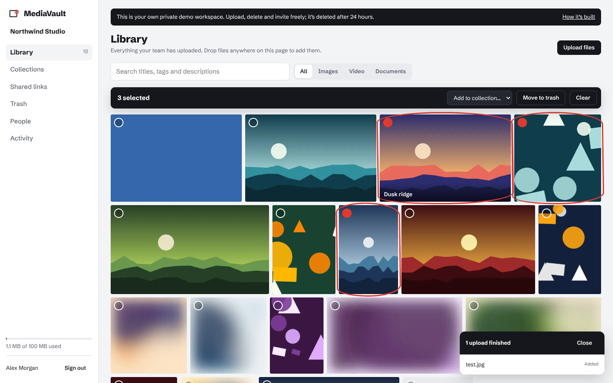
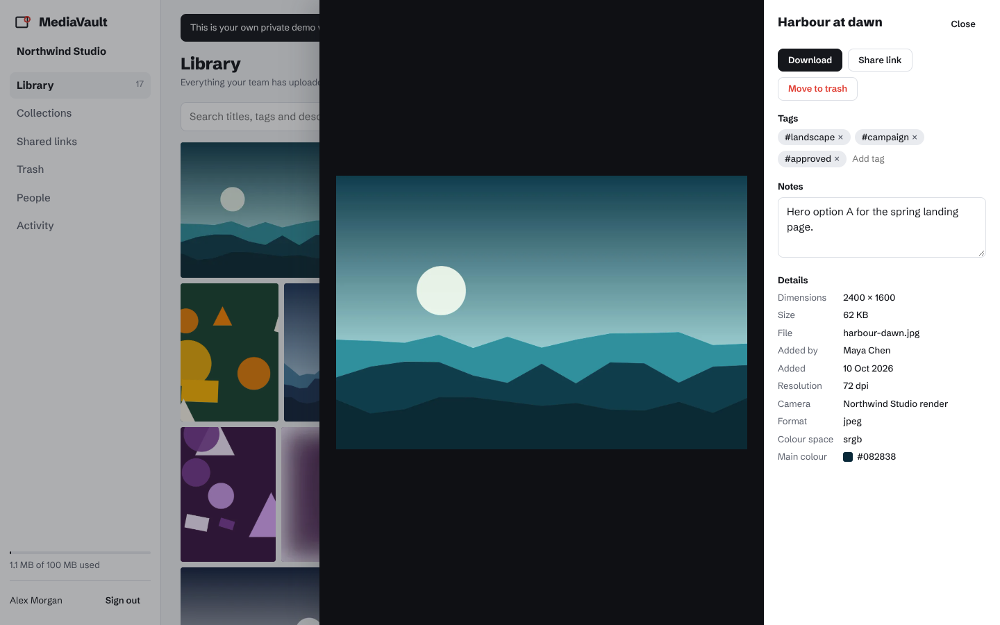
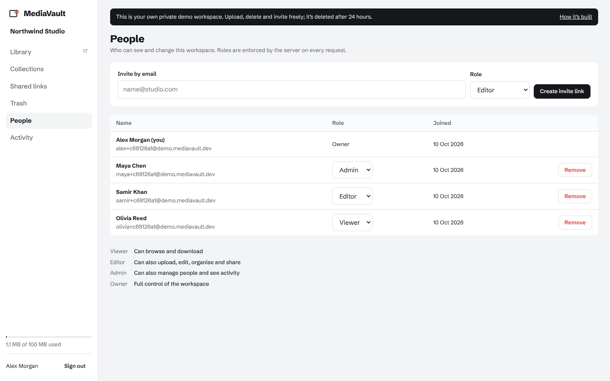
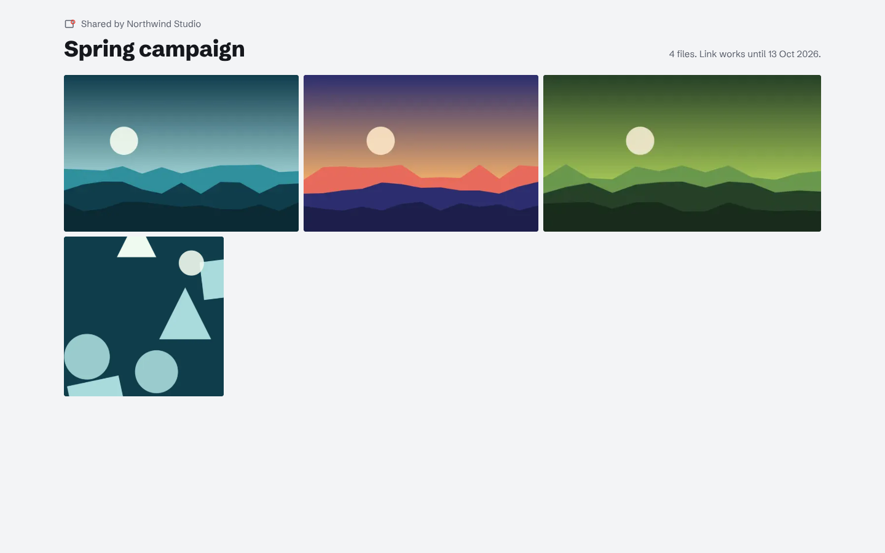
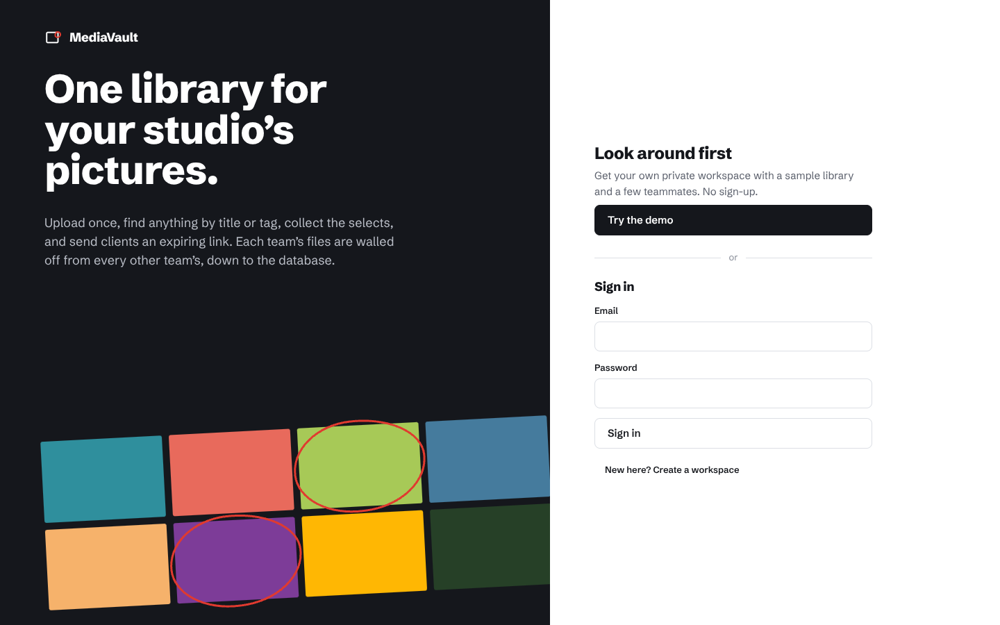
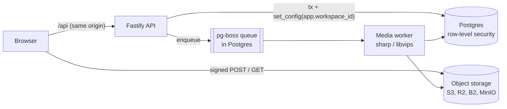

# MediaVault

**A shared media library for creative teams, built as a real multi-tenant SaaS.**

Teams upload pictures, video and PDFs straight to object storage, find them by title,
tag or description, gather the selects into collections, and send clients expiring
links. Every team's files are isolated by Postgres row-level security, so a bug in
a query returns nothing rather than someone else's data.

[](https://github.com/Tariqali13/MediaVault/actions/workflows/ci.yml)


<p align="center">
  
</p>

## What's interesting here

**Tenant isolation in the database, not in every WHERE clause.** Each request runs in
a transaction that sets `app.workspace_id`; `FORCE ROW LEVEL SECURITY` policies compare
against it on every tenant table. The tests prove it with deliberately careless SQL:
an unfiltered `SELECT * FROM assets` returns only the caller's rows, inserts into
another tenant fail, updates silently skip, and the context can't leak to the next
request on a pooled connection.

**Uploads never touch the API.** The API reserves quota atomically (no two parallel
uploads can squeeze past the limit), then hands the browser a signed POST policy. The
bucket itself enforces the exact key, content type and maximum size. After upload, a
background worker reads the bytes to check the file really is what it claims (an HTML
file labelled `image/png` is rejected and its quota returned), extracts EXIF, honours
orientation, and renders WebP thumbnails and previews.

**One permission matrix, two consumers.** Roles (viewer, editor, admin, owner) live in a
shared package. The API enforces them; the web app uses the same table to hide what you
can't do. A test spells out every role/action pair, so any access change is a visible
diff. Admins can't create admins or touch owners, and a workspace can never lose its
last owner.

**Details that usually get skipped:**
- Keyset pagination (stable under concurrent uploads, no `OFFSET` scans) with millisecond
  timestamps so cursors round-trip exactly through JavaScript.
- Signed URLs pinned to hourly windows, so the same thumbnail has the same URL for an
  hour and the browser cache actually works.
- Share links and invites store only a SHA-256 of the token; the raw token is shown once.
- Audit events are written in the same transaction as the change they describe.
- Login takes the same time and returns the same error whether or not the email exists.
- CSRF defence: `SameSite=Lax` session cookies plus an Origin check on every mutation,
  with the API served same-origin through the web host's proxy.

## Try it

**Live demo: [media-vault-tariqali.netlify.app](https://media-vault-tariqali.netlify.app)** (free tier:
the first visit after a quiet spell takes ~30 s while the API wakes up). Deployment notes
are in [DEPLOY.md](DEPLOY.md).

"Try the demo" creates **your own private workspace** with a sample library and three
teammates, so you can upload, delete, invite and change roles without affecting anyone
else. Demo workspaces are deleted after 24 hours.

| | |
| --- | --- |
|  |  |
|  |  |

## Architecture



- **No Redis, no separate queue service.** Jobs live in Postgres via pg-boss, so the
  whole system is one database plus object storage, and runs on free tiers.
- **The worker can run in-process** (one free service) or as its own deployment
  (`RUN_WORKER_IN_PROCESS=false`, `node dist/worker.js`) when uploads are heavy.
- **Storage is behind a five-method interface.** The S3 driver works with any
  S3-compatible service; a local driver reproduces signed POST/GET semantics on disk so
  development and tests behave the same as production.

More in [docs/ARCHITECTURE.md](docs/ARCHITECTURE.md) and the [decision records](docs/adr).

## Tests

```bash
npm test     # 41 API integration tests, 71 permission-matrix cases, 5 layout tests
```

The API suite runs against real Postgres **as a non-superuser** and refuses to start
otherwise (superusers bypass RLS, which would make the isolation tests meaningless). CI
also runs the S3 driver against MinIO, including the bucket rejecting an oversized upload.

## Run locally

```bash
# Postgres with a non-superuser app role
psql -U postgres -f infra/postgres-init.sql
npm install
npm run dev          # API on :4100, web on :5174 (API docs at /api/docs)
```

Or the full stack with S3-compatible storage and a separate worker:
`docker compose up --build`, then `npm run dev -w @mediavault/web`.

## Stack

| | |
| --- | --- |
| API | Node.js 22, TypeScript (strict), Fastify 5, Zod, Drizzle ORM, OpenAPI |
| Data | PostgreSQL 16 (row-level security, full-text search, trigram index), pg-boss |
| Media | sharp/libvips, EXIF parsing, S3 presigned POST |
| Auth | argon2id, httpOnly session cookies, hashed invite and share tokens |
| Web | React 19, TanStack Query, justified-row gallery, no UI kit |
| Quality | Vitest against real Postgres and MinIO, GitHub Actions, Docker |

## Project layout

```
packages/shared     roles, permission matrix, API contracts (used by API and web)
apps/api/migrations schema and row-level security policies
apps/api/src
  db/               Drizzle schema, tenant-scoped transactions, migrator
  routes/           auth, assets, collections, shares, members
  storage/          S3 and local drivers
  media/            file sniffing, image processing, job queue
  demo/             per-visitor demo workspaces and procedural sample art
apps/web/src        React client
docs/               architecture notes and ADRs
```

---

Built by [Tariq Ali](https://tariqali.dev). Sample images are generated procedurally; no
real customer data or media is included.
